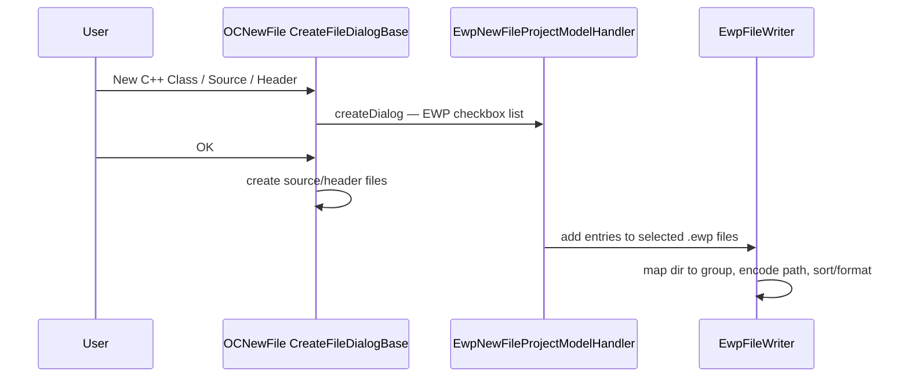
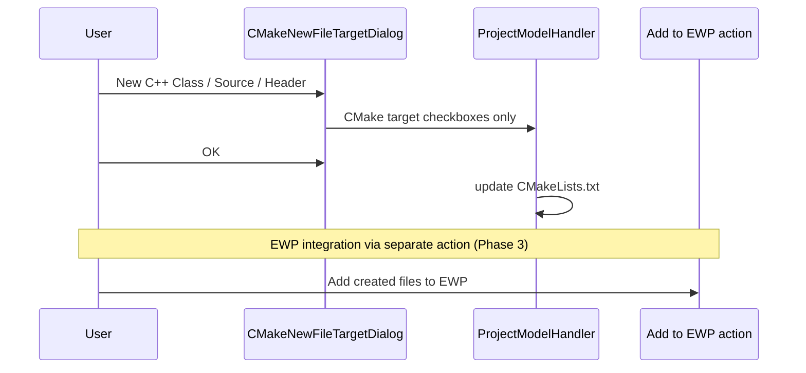

# Plan: Add new source files to EWP from CLion new-file dialog

> **Superseded.** Phase 0 spike is complete; production approach is the post-create dialog plan: [plan-post-create-ewp-dialog.md](plan-post-create-ewp-dialog.md)

Status: **archived** (Phase 0 complete)

## Goal

When creating C/C++ files via CLion (C++ Class, C/C++ Source, C/C++ Header), let the user select which `.ewp` files should receive the new file(s). Ideally, EWP targets appear in the same checkbox list as CMake targets in the existing new-file dialog.

Related requirement: [requirements.md](requirements.md) — nice-to-have “When creating a class in Clion, offer to add the new files to the ewp too, just like it is supported with Cmakelists”.

## Background: how CLion does it for CMake

CLion new C/C++ file actions use:

- `OCNewFileActionBase` / `CreateFileDialogBase`
- `OCNewFileProjectModelHandler` — hooks extra UI and post-create logic into the dialog

CMake integrates via a CLion extension point:

| Item | Value |
|------|--------|
| Extension point | `cidr.lang.newFileModelHandlerProvider` |
| Interface | `com.jetbrains.cidr.lang.actions.newFile.OCNewFileProjectModelHandlerProvider` |
| CMake registration | `CPPNewFileProjectModelHandlerProvider` in `intellij.cmake.clion.xml` |
| CMake handler | `ProjectModelHandler` → `CMakeNewFileTargetDialog` (in `intellij.cmake.clion.jar`) |

CMake UI is built on internal (but reusable) classes in `intellij.cmake.core`:

- `AddToTargetComponentsHandlerBase` / `AddToTargetComponentsManagerBase`
- `NewFileTarget` — model for a selectable target in the list

There is no separate public “extend the CMake target list” API. The intended integration path is `newFileModelHandlerProvider`.

### Extension point selection semantics (Phase 0 finding)

`OCNewFileProjectModelHandlerProvider.getInstance(Project)` does **not** compose multiple providers:

1. Loads all `cidr.lang.newFileModelHandlerProvider` extensions
2. Filters to those where `isApplicable(project)` is true
3. Returns **only the first** match (`extensionList.get(0)`)

CMake’s provider returns `isApplicable = true` when `CMakeWorkspaceInitializationUtil.isCMakeWorkspaceInitialized(project)`.

**Conclusion:** EWP and CMake **cannot** appear as separate providers in the same dialog. A second registered provider is ignored whenever an earlier applicable provider exists (CMake loads before third-party plugins, so CMake wins on CMake + EWP projects).

## Current plugin state

**Already implemented:**

- EWP parsing: `EwpParser`, `EwpIndexService`
- Path resolution: `EwpPathResolver` (`$PROJ_DIR$` → absolute path)
- Sort/format on change: `EwpDomSortFixer`, `EwpDocumentFormatter`
- Explorer tool window (read-only view)
- **Phase 0 spike** (`newfile` package):
  - `EwpNewFileProjectModelHandlerProvider` — registered on `cidr.lang.newFileModelHandlerProvider`
  - `EwpNewFileProjectModelHandler` — logs dialog lifecycle (no EWP writes yet)
  - `EwpNewFileExtensionProbe` — logs all registered providers + `getInstance()` selection at project open
  - `EwpNewFileSpikeLogger` — `#EwpNewFileSpike` log category
- Gradle: `bundledPlugin("com.intellij.clion")` only (Nova-compatible; no Classic Engine plugin needed)
- `plugin.xml`: `com.intellij.modules.clion` dependency only

**Missing for this feature:**

- EWP write/mutation (add file entries, create subgroups)
- Directory → EWP group mapping (requirements rules 1–4)
- Reverse path encoding (absolute path → `$PROJ_DIR$\..\src\...`)
- Production dialog integration (composite handler — see Phase 2)

## Phase 0 — Spike ✅ Complete

### What was done

1. Added Gradle dependencies for CLion 2026.2 (see [Build setup](#build-setup-clion-20262) below).
2. Implemented minimal `EwpNewFileProjectModelHandlerProvider` + handler that log when selected.
3. Added startup probe logging all EP extensions and which provider `getInstance()` picks.

### Answer to the critical open question

| Question | Answer |
|----------|--------|
| Can multiple `newFileModelHandlerProvider` extensions coexist? | They **register** side by side, but CLion uses **only one** via `getInstance()`. |
| Same list as CMake? | **No** — not via a separate EWP provider. CMake targets and EWP targets cannot be merged by registering two providers. |
| Recommended UX | **Composite handler** (Phase 2): one provider whose handler delegates to CMake when applicable and adds an EWP section. |

### Provider selection by project type

| Project | CMake `isApplicable` | EWP `isApplicable` | `getInstance()` winner | EWP spike handler runs? |
|---------|---------------------|-------------------|------------------------|-------------------------|
| EWP only (no CMake) | false | true | EWP (if no earlier applicable provider) | Yes |
| CMake only | true | false | CMake | No |
| CMake + EWP | true | true | **CMake** (bundled plugin loads first) | No |

### Manual verification

1. `./gradlew runIde`
2. Open project with `.ewp` file(s)
3. Check log for `#EwpNewFileSpike` — extension probe on project open
4. Trigger **New → C++ Class / C/C++ Source / C/C++ Header**
5. On EWP-only projects: expect `createDialog` / `doCreateFiles` log lines
6. On CMake + EWP projects: probe shows CMake selected; EWP handler not invoked

## Recommended approach

### Phase 1 — Core EWP mutation layer

New package, e.g. `com.github.kellpete.intellijewpsupport.ewp.editor`:

| Component | Responsibility |
|-----------|----------------|
| `EwpPathEncoder` | Absolute path → `$PROJ_DIR$\..\\src\\foo.cpp` (inverse of `EwpPathResolver`) |
| `EwpGroupMapper` | Map target directory to EWP group path using requirements rules 1–4 |
| `EwpFileWriter` | JDOM: insert `<file><name>…</name></file>`, create missing `<group>` nodes |
| Reuse `EwpDomSortFixer.sortAndFormat()` | Preserve sort order and formatting after every edit |

Unit tests using `src/test/testData/sample/sample.ewp` and the mapping examples in requirements.md.

#### Group mapping rules (from requirements)

For a new file in directory `D`:

1. **Obvious mapping:** If the EWP already contains files in `D`, use that group.
2. **Parent walk:** Walk up to project root; if a parent has an obvious mapping, use it and add subgroups for subfolders.
3. **Shortest-path fallback:** Use shortest file path in EWP; build mapping from deepest common directory.
4. **Filesystem fallback:** Create groups matching filesystem directories.

After mapping, create any missing subgroup chain and insert the file entry.

### Phase 2 — Dialog integration (composite handler)

Phase 0 confirmed that registering a standalone EWP provider is **insufficient** for CMake + EWP projects. Phase 2 must use a **single winning provider** with a handler that composes behavior.

#### Architecture

Replace the spike provider/handler with a production composite:

1. **`EwpNewFileProjectModelHandlerProvider`** (keep registration, refine `isApplicable`):
   - `isApplicable(project)` = project has `.ewp` files **OR** delegate-only mode when wrapping CMake is needed
   - For CMake + EWP: provider must win over CMake → **requires registering before CMake** (not possible for third-party plugins) **OR** wrap CMake from within CMake’s slot (not possible) **OR** accept that on CMake projects we must **hook differently**

**Revised strategy for CMake + EWP coexistence:**

Because third-party plugins cannot load before bundled CMake, on CMake + EWP projects our standalone provider **never wins**. Options:

| Option | Approach | Feasibility |
|--------|----------|-------------|
| **A. EWP-only projects** | Current provider works when CMake not initialized | ✅ Already works (spike verified) |
| **B. CMake + EWP projects** | Composite handler inside CMake’s dialog via listener/hook | ❌ No hook point |
| **C. CMake + EWP projects** | Register provider with `order="first"` if EP supports it | ⚠️ Investigate — standard EP has no order attribute |
| **D. CMake + EWP projects** | Subclass/wrap `ProjectModelHandler` by replacing provider | ❌ Cannot replace bundled registration |
| **E. CMake + EWP projects** | **Separate “Add to EWP…” post-create action** or notification | ✅ Fallback UX, not in same dialog |
| **F. CMake + EWP projects** | **Composite `createDialog` when EWP provider wins; when CMake wins, add EWP panel via `CMakeNewFileTargetDialog` extension** | ❌ No extension point on dialog |

**Recommended path forward:**

- **Primary (EWP-only / embedded IAR projects without CMake):** Full new-file dialog integration via `EwpNewFileProjectModelHandler` with EWP checkbox list (reuse or mirror `AddToTargetComponentsManagerBase`).
- **Secondary (CMake + EWP hybrid):** Add a separate **“Add to EWP…”** action for newly created/existing files (Phase 3 optional follow-up), OR investigate whether `CMakeNewFileTargetDialog` can be extended via UI injection in our handler when we **do** win (N/A on hybrid projects).

> **Open item for Phase 2 start:** Confirm target user workflow — are CMake + EWP hybrid projects common? If yes, prioritize the standalone “Add to EWP…” action alongside dialog integration for EWP-only projects.

#### When EWP provider is selected (EWP-only projects)

Implement in `EwpNewFileProjectModelHandler`:

1. **`createDialog`** — build dialog with EWP checkbox list (reuse `AddToTargetComponentsManagerBase` if feasible from `intellij.cmake.core`, or a simple checkbox panel).
2. **`doCreateFiles`** — after file creation, call `EwpFileWriter` for each selected `.ewp`.
3. **`EwpNewFileTarget`** — model for a selectable EWP: display name = `project.ewp`, identity = `VirtualFile`.

**Smart defaults** (mirror CMake “best target” behavior):

- Pre-check EWPs that already contain a sibling file in the same directory.
- If none match, pre-check all EWPs or none (decide during implementation; consider user setting).

**C++ Class:** one confirmation adds both `.cpp` and `.hpp` (or configured extensions) to each selected EWP.

#### Registration (unchanged from spike)

```xml
<depends>com.intellij.modules.clion</depends>

<extensions defaultExtensionNs="cidr.lang">
  <newFileModelHandlerProvider
      implementation="com.github.kellpete.intellijewpsupport.newfile.EwpNewFileProjectModelHandlerProvider"/>
</extensions>
```

Remove spike-only `EwpNewFileExtensionProbe` and verbose logging before release.

### Phase 3 — Polish

- Persistent settings: remember last EWP selection; option for default none/all.
- Hide/disable section when project has no `.ewp` files.
- Invalidate `EwpIndexService` and refresh explorer after writes.
- **CMake + EWP hybrid:** “Add to EWP…” action for existing/newly created files (similar to CMake’s “Add to CMake Project”).
- Remove Phase 0 spike logging / probe.

### Phase 4 — Tests

| Layer | Tests |
|-------|--------|
| `EwpGroupMapper`, `EwpPathEncoder`, `EwpFileWriter` | Unit tests (no IDE) |
| Provider/handler | CLion test framework or headless where possible |
| Manual | New class in mapped/unmapped dirs; multiple EWPs; EWP-only vs CMake + EWP; verify sort order |

## Target flow

### EWP-only projects (provider wins)



### CMake + EWP hybrid projects (CMake provider wins)



## EWP write constraints

When modifying `.ewp` files, always apply existing formatting rules:

- Expanded empty elements (`<state></state>`), except `<data />` self-closing
- Keep XML header and trailing newline after `</project>`
- 4 spaces per indentation level
- Sort: subgroups first (alpha), then files (alpha by filename only)

Use `WriteCommandAction` and `EwpDomSortFixer.sortAndFormat()` after structural changes (same pattern as `EwpDocumentFormatter`).

## Build setup (CLion 2026.2, Nova)

New-file dialog APIs (`OCNewFileProjectModelHandler*`, `cidr.lang.newFileModelHandlerProvider`) live in the **`intellij.cidr.lang.base`** module, which is **bundled inside the CLion plugin** — not in the Classic Engine marketplace plugin (`com.intellij.cidr.lang`).

For Nova-only development you do **not** need `compatiblePlugin("com.intellij.cidr.lang")` or `<depends>com.intellij.modules.cidr.lang</depends>`. Those refer to the optional Classic Engine plugin (PSI, `OCFileType`, etc.) which this feature does not use.

`build.gradle.kts`:

```kotlin
intellijPlatform {
    clion("2026.2")
    bundledPlugin("com.intellij.clion")  // includes intellij.cidr.lang.base
}
```

`plugin.xml`:

```xml
<depends>com.intellij.modules.clion</depends>
```

Only add `compatiblePlugin("com.intellij.cidr.lang")` if the plugin later needs Classic Engine APIs (`OCFile`, `OCLanguage`, etc.).

## Risks and mitigations

| Risk | Mitigation |
|------|------------|
| ~~Extension point behavior undocumented~~ | **Resolved (Phase 0):** only first applicable provider used; composite/separate-action strategy required |
| CMake + EWP hybrid: EWP provider never selected | EWP-only dialog integration + separate “Add to EWP…” action for hybrid projects |
| Internal APIs (`AddToTargetComponents*`) | Prefer official EP; accept version risk or duplicate minimal checkbox UI |
| Ambiguous group mapping | Implement rules 1–4 strictly; optional status/tooltip showing chosen group |
| Class creation = 2 files × N EWPs | Single write command per EWP; batch both files in one pass |
| Confusing Classic vs base modules | New-file EP is in `intellij.cidr.lang.base` (bundled); do not depend on marketplace `com.intellij.cidr.lang` unless using Classic PSI APIs |

## Suggested implementation order

1. ~~Phase 0 — spike: provider registration + coexistence with CMake~~ ✅
2. Phase 1 — `EwpFileWriter` + mapper + encoder + unit tests
3. Phase 2 — production handler + EWP target list (EWP-only projects)
4. Phase 3 — defaults, persistence, explorer refresh, hybrid-project “Add to EWP…” action
5. Phase 4 — automated + manual QA

## References (CLion 2026.2)

| Resource | Location |
|----------|----------|
| Extension point | `intellij.cidr.lang.base.jar` — `cidr.lang.newFileModelHandlerProvider` |
| Provider base | `com.jetbrains.cidr.lang.actions.newFile.OCNewFileProjectModelHandlerProvider` |
| Handler interface | `com.jetbrains.cidr.lang.actions.newFile.OCNewFileProjectModelHandler` |
| Default dialog | `com.jetbrains.cidr.lang.actions.newFile.DirectoryBasedCreateFileDialog` |
| CMake provider | `intellij.cmake.clion.jar` — `CPPNewFileProjectModelHandlerProvider` |
| CMake handler | `intellij.cmake.clion.jar` — `ProjectModelHandler` → `CMakeNewFileTargetDialog` |
| CMake UI base | `intellij.cmake.core.jar` — `AddToTargetComponentsHandlerBase`, `AddToTargetComponentsManagerBase` |
| Phase 0 spike code | `src/main/kotlin/.../newfile/` |
