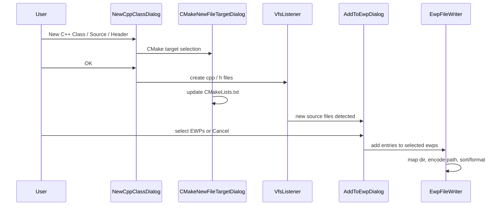

# Plan: Add new source files to EWP via post-create dialog

Status: **planned** (supersedes [plan-new-file-ewp-integration.md](plan-new-file-ewp-integration.md))

## Goal

When creating C/C++ files via CLion (C++ Class, C/C++ Source, C/C++ Header), offer a **second dialog** — after the New
C++ Class / Source / Header dialog and CMake target selection — to optionally add the new file (s) to selected `.ewp`
files.

Similar to the **“Add Files to Git”** dialog that appears after file creation: modal, skippable, no obligation.

Related requirement: [requirements.md](requirements.md) — nice-to-have “When creating a class in Clion, offer to add the
new files to the ewp too, just like it is supported with Cmakelists”.

## Design decisions (confirmed)

| Decision              | Choice                                                       | Rationale                                                           |
|-----------------------|--------------------------------------------------------------|---------------------------------------------------------------------|
| Integration point     | **Post-create dialog**                                       | Phase 0 proved in-dialog integration cannot coexist with CMake      |
| Project model         | **CMake + EWP only**                                         | CLion workflow is CMake; there are no EWP-only projects             |
| Skip / Cancel         | **Allowed and desired**                                      | Unit tests and other files often should not be in `.ewp`            |
| Smart default         | **Pre-check EWPs with a sibling file in the same directory** | Strong signal for the right target(s)                               |
| Reminders             | **None**                                                     | Do not notify when files are not in any EWP — normal for unit tests |
| “Don’t ask again”     | **Not in scope**                                             | Can add later if needed                                             |
| Classic Engine plugin | **Not required**                                             | Nova + bundled `intellij.cidr.lang.base` is sufficient              |

## Why not the New C++ Class dialog?

Phase 0 spike ([plan-new-file-ewp-integration.md](plan-new-file-ewp-integration.md)) investigated
`cidr.lang.newFileModelHandlerProvider`:

- CMake registers `CPPNewFileProjectModelHandlerProvider` on that extension point.
- `OCNewFileProjectModelHandlerProvider.getInstance(project)` returns **only the first applicable provider**.
- On all real projects (CMake initialized), **CMake always wins**; a separate EWP provider is never invoked.
- There is no public API to extend CMake’s target checkbox list.

**Conclusion:** Abandon `newFileModelHandlerProvider` for this feature. Remove Phase 0 spike registration after
post-create dialog is implemented.

## Target flow



User may **Cancel** the EWP dialog — files remain on disk and in CMake; `.ewp` unchanged.

## Current plugin state

**Already implemented:**

- EWP parsing: `EwpParser`, `EwpIndexService`
- Path resolution: `EwpPathResolver` (`$PROJ_DIR$` → absolute path)
- Sort/format on change: `EwpDomSortFixer`, `EwpDocumentFormatter`
- Explorer tool window (read-only view)

**Phase 0 spike (was removed again):**

- `newfile` package — `EwpNewFileProjectModelHandlerProvider`, handler, probe, logger
- `plugin.xml` registration on `cidr.lang.newFileModelHandlerProvider`

**Missing for this feature:**

- EWP write/mutation layer (Phase 1)
- Post-create detection + dialog (Phase 2)
- Explorer refresh after writes (Phase 3)

## Recommended approach

### Phase 1 — Core EWP mutation layer

New package: `com.github.kellpete.intellijewpsupport.ewp.editor`

| Component                               | Responsibility                                                               |
|-----------------------------------------|------------------------------------------------------------------------------|
| `EwpPathEncoder`                        | Absolute path → `$PROJ_DIR$\..\\src\\foo.cpp` (inverse of `EwpPathResolver`) |
| `EwpGroupMapper`                        | Map target directory to EWP group path using requirements rules 1–4          |
| `EwpFileWriter`                         | JDOM: insert `<file><name>…</name></file>`, create missing `<group>` nodes   |
| Reuse `EwpDomSortFixer.sortAndFormat()` | Preserve sort order and formatting after every edit                          |

Unit tests using `src/test/testData/sample/sample.ewp` and mapping examples in [requirements.md](requirements.md).

#### Group mapping rules (from requirements)

For a new file in directory `D`:

1. **Obvious mapping:** If the EWP already contains files in `D`, use that group.
2. **Parent walk:** Walk up to project root; if a parent has an obvious mapping, use it and add subgroups for
   subfolders.
3. **Shortest-path fallback:** Use shortest file path in EWP; build mapping from deepest common directory.
4. **Filesystem fallback:** Create groups matching filesystem directories (ignoring "..")

After mapping, create any missing subgroup chain and insert the file entry.

### Phase 2 — Post-create detection and dialog

New package: `com.github.kellpete.intellijewpsupport.ewp.addfiles` (or similar)

#### 2a. File creation listener

Subscribe to VFS changes (e.g. `BulkFileListener` on project message bus — same pattern as `EwpIndexService`).

**Trigger dialog when:**

- Project has at least one `.ewp` file (`EwpIndexService.findEwpFiles()` non-empty)
- One or more **new** files with C/C++ source extensions (`.c`, `.cpp`, `.cc`, `.cxx`, `.h`, `.hpp`, `.hh`, …)
- File is under project content roots (not library/external paths)

**Do not trigger when:**

- `.ewp` file itself changed
- File already listed in **all** project EWPs (optional optimization — skip dialog if nothing to add)

**Batching (C++ Class):**

- Debounce rapid creates in the same directory (e.g. 300–500 ms) so `.cpp` + `.hpp` open **one** dialog listing both
  files.

**Explicitly out of scope:**

- Notifications or reminders when files are **not** in any EWP (unit tests, generated code — expected)
- “Don’t ask again” setting

#### 2b. `AddToEwpDialog`

Standard `DialogWrapper` with:

- Title e.g. “Add to EWP Project”
- List of project `.ewp` files as checkboxes (label = filename, e.g. `firmware.ewp`)
- Summary of file (s) being added
- **OK** → write to selected EWPs via `EwpFileWriter`
- **Cancel** → no-op (desired)

#### 2c. Smart defaults

On open, **pre-check EWPs that already contain at least one file in the same directory** as the new file (s):

- Use `EwpIndexService` + resolved absolute paths from `EwpPathResolver`
- If multiple EWPs match, check all of them
- If none match, leave all unchecked (user selects manually or cancels)

Do **not** pre-check all EWPs by default.

#### 2d. Write path

For each selected `.ewp` and each new file:

1. `EwpGroupMapper` → target group
2. `EwpPathEncoder` → `$PROJ_DIR$\..\\…` path
3. `EwpFileWriter` insert + `EwpDomSortFixer.sortAndFormat()`
4. `WriteCommandAction` per EWP (batch all new files for that EWP in one command)

#### 2e. Cleanup Phase 0 spike (already done)

Remove:

- `cidr.lang.newFileModelHandlerProvider` from `plugin.xml`
- `newfile/*` spike classes (`EwpNewFileProjectModelHandlerProvider`, handler, probe, logger)

### Phase 3 — Polish

- Invalidate `EwpIndexService` and refresh explorer after writes
- Optional: **“Add to EWP…”** context action for existing files (requirements nice-to-have; separate from post-create
  flow)
- Dialog UX polish: remember last checkbox selection **within the dialog session** only (no persistent “don’t ask
  again”)

**Not planned:**

- Persistent “don’t ask again” / per-project opt-out
- Notifications when files are missing from EWP

### Phase 4 — Tests

| Layer                                               | Tests                                                                                                                                                                                    |
|-----------------------------------------------------|------------------------------------------------------------------------------------------------------------------------------------------------------------------------------------------|
| `EwpGroupMapper`, `EwpPathEncoder`, `EwpFileWriter` | Unit tests (no IDE)                                                                                                                                                                      |
| Sibling pre-check logic                             | Unit tests with fixture EWPs + paths                                                                                                                                                     |
| Listener batching / extension filter                | Unit or light IDE tests                                                                                                                                                                  |
| Manual                                              | New class in mapped dir (siblings pre-checked); new file in unmapped dir; multiple EWPs; Cancel skips write; unit test file created → dialog shown but Cancel is fine; verify sort order |

## EWP write constraints

When modifying `.ewp` files, always apply existing formatting rules:

- Expanded empty elements (`<state></state>`), except `<data />` self-closing
- Keep XML header and trailing newline after `</project>`
- 4 spaces per indentation level
- Sort: subgroups first (alpha), then files (alpha by filename only)

Use `WriteCommandAction` and `EwpDomSortFixer.sortAndFormat()` after structural changes (same pattern as
`EwpDocumentFormatter`).

## Build setup (CLion 2026.2, Nova)

Post-create approach does **not** need `newFileModelHandlerProvider` or Classic Engine.

```kotlin
// build.gradle.kts
intellijPlatform {
    clion("2026.2")
    bundledPlugin("com.intellij.clion")
}
```

```xml
<!-- plugin.xml -->
<depends>com.intellij.modules.clion</depends>
```

No `compatiblePlugin("com.intellij.cidr.lang")` unless Classic PSI APIs are needed later.

## Risks and mitigations

| Risk                                              | Mitigation                                                                |
|---------------------------------------------------|---------------------------------------------------------------------------|
| Dialog fires on unwanted creates (refactor, copy) | Filter by extension + content roots; optional skip if already in all EWPs |
| C++ Class creates two files                       | Debounce/batch in same directory                                          |
| User annoyed by dialog for test files             | Cancel is OK; no follow-up notifications                                  |
| Ambiguous group mapping                           | Rules 1–4 + optional tooltip showing chosen group in dialog               |
| Class = 2 files × N EWPs                          | Single `WriteCommandAction` per EWP per batch                             |
| Listener runs before file fully written           | Trigger on `VFileCreateEvent` after content flush, or short EDT defer     |

## Suggested implementation order

1. Phase 1 — `EwpFileWriter` + mapper + encoder + unit tests
2. Phase 2 — VFS listener + `AddToEwpDialog` + sibling pre-check; remove Phase 0 spike
3. Phase 3 — explorer refresh; optional “Add to EWP…” action for existing files
4. Phase 4 — automated + manual QA

## References

| Resource                                                             | Relevance                                              |
|----------------------------------------------------------------------|--------------------------------------------------------|
| [requirements.md](requirements.md)                                   | Group mapping rules, nice-to-have                      |
| [plan-new-file-ewp-integration.md](plan-new-file-ewp-integration.md) | Phase 0 spike findings (archived approach)             |
| `EwpIndexService`                                                    | Find EWPs, invalidate cache                            |
| `EwpPathResolver`                                                    | Directory sibling detection for pre-check              |
| Git “Add Files to Git” UX                                            | Post-create modal precedent in CLion                   |
| Phase 0 spike code                                                   | `src/main/kotlin/.../newfile/` — **remove in Phase 2** |
